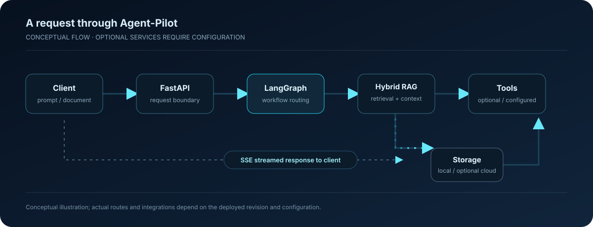

  

  <h1>Agent-Pilot</h1>
  
<strong>A document-grounded AI workspace with a graph-based agent workflow.</strong>

  
<a href="https://github.com/Geetansh124/Agent-Pilot">Repository</a> · <a href="https://github.com/Geetansh124/Agent-Pilot/tree/main/docs">Documentation</a>

  

    
    
    
    
  

> **Status:** research and development. Run locally with your own provider credentials. The Cloudflare-hosted sign-in page and health route respond, but the full workflow has not been verified end to end; no demo link is published yet.

## What it does

Agent-Pilot brings document question-answering and tool-using AI workflows into one workspace. Add documents, retrieve relevant context, route a request through a LangGraph workflow, and return a response through the web client. The repository includes a Next.js frontend, a FastAPI service, retrieval components, and optional storage/tool integrations. Which integrations work depends on local configuration and credentials.

## Contents

- [At a glance](#at-a-glance)
- [Product experience](#product-experience)
- [Architecture](#architecture)
- [Capabilities in the codebase](#capabilities-in-the-codebase)
- [Quickstart](#quickstart)
- [Configuration](#configuration)
- [API surface](#api-surface)
- [Validation](#validation)
- [Status and limitations](#status-and-limitations)
- [Security and responsible use](#security-and-responsible-use)
- [License](#license)

## At a glance

| Area | What the project provides |
| --- | --- |
| Retrieval | Dense and keyword retrieval components for document-grounded responses |
| Orchestration | A LangGraph workflow for multi-step assistant behavior |
| User separation | Authentication and user-scoped conversations/documents in the API design |
| Streaming | Server-Sent Events endpoint for streamed responses and workflow events |
| Storage | Local storage plus optional cloud adapters, depending on configuration |
| Tools | Retrieval, calculation, search, and data tools; external services may need keys |

## Product experience

The diagram is a **conceptual** view of the request path. It describes the intended flow; optional tools and remote storage are only active when configured and reachable.

## Architecture

    Next.js client  ── HTTP / SSE ──>  FastAPI API
                                          │
                                          ├── Authentication and request handling
                                          ├── LangGraph workflow
                                          │     ├── Hybrid retrieval (dense + BM25)
                                          │     └── Optional tools
                                          └── Storage adapters (local or configured cloud)

This reflects repository structure and documented components. It does not imply that a hosted service is currently running.

## Capabilities in the codebase

| Component | Repository implementation / documented role |
| --- | --- |
| Web client | Next.js app with chat and document workflows |
| API | FastAPI routes for authentication, conversations, chat, streaming, and documents |
| Retrieval | Dense embeddings and BM25-based keyword retrieval |
| Workflow | LangGraph stateful orchestration and tool routing |
| Persistence | Local storage and optional Google Drive / S3 adapters |
| Integrations | Optional tools may require third-party credentials and network access |

Behavior depends on the checked-out revision, environment variables, and configured services. Review the source and run the validation steps below before relying on a capability.

## Quickstart

### Prerequisites

- Python 3.10 or newer
- Node.js 18 or newer and npm
- An API key for the model provider configured by your backend environment

### 1. Clone and prepare the backend

PowerShell:

    git clone https://github.com/Geetansh124/Agent-Pilot.git
    cd Agent-Pilot
    py -3 -m venv .venv
    .\.venv\Scripts\Activate.ps1
    python -m pip install --upgrade pip
    pip install -r requirements.txt

macOS / Linux:

    git clone https://github.com/Geetansh124/Agent-Pilot.git
    cd Agent-Pilot
    python3 -m venv .venv
    source .venv/bin/activate
    python -m pip install --upgrade pip
    pip install -r requirements.txt

### 2. Configure the environment

Copy <code>.env.example</code> to <code>.env</code> in the repository root and fill only the provider or integration values you plan to use. Keep <code>.env</code> private; it contains secrets and should never be committed.

### 3. Start the API

    uvicorn api_server:app --host 127.0.0.1 --port 8000 --reload

The API is available at <code>http://127.0.0.1:8000</code>; interactive API documentation is at <code>http://127.0.0.1:8000/docs</code>.

### 4. Start the frontend

In a second terminal, from the repository root:

    cd frontend
    npm ci
    npm run dev

Open the local frontend at <code>http://localhost:3000</code>. If the frontend cannot reach the API, check the configured API base URL and backend CORS origin list.

## Configuration

Start from [<code>.env.example</code>](.env.example). The example contains placeholders only. Set a model-provider key before using model-backed chat. Add optional integration credentials only if you intend to enable those services. Use a long, random JWT secret outside local development, and restrict allowed frontend origins to the domains you operate.

## API surface

These routes are documented by the project. Check the running API’s <code>/docs</code> page for exact request and response schemas for your revision.

| Method | Route | Purpose |
| --- | --- | --- |
| GET | <code>/health</code> | Service health information |
| POST | <code>/api/auth/register</code> | Register an account |
| POST | <code>/api/auth/login</code> | Authenticate and obtain a token |
| GET | <code>/api/auth/me</code> | Read the current user profile |
| GET / POST | <code>/api/threads</code> | List or create conversations |
| GET / PATCH / DELETE | <code>/api/threads/{thread_id}</code> | Read, rename, or delete a conversation |
| POST | <code>/api/chat</code> | Send a message and receive a response |
| POST | <code>/api/chat/stream</code> | Stream response and workflow events using SSE |
| GET | <code>/api/documents</code> | List documents for the current user |
| POST | <code>/api/documents/upload</code> | Upload and index a document |
| POST | <code>/api/threads/{thread_id}/documents/{doc_id}/attach</code> | Attach a document to a conversation |
| GET | <code>/api/threads/{thread_id}/document</code> | Read the attached document |
| POST | <code>/mcp</code> | MCP JSON-RPC handler, if enabled in the deployment |

## Validation

The repository documents these local checks:

    python -m unittest discover -s tests -p "test_*.py"
    cd frontend
    npm run build

These commands are guidance; this README does not claim that they have run successfully for the current commit. A passing local run does not by itself verify external integrations or a hosted deployment.

## Status and limitations

- **Local setup:** Model-backed features require valid provider credentials and installed dependencies.
- **Cloudflare frontend:** The sign-in page at `https://agent-pilot.soapy-pint.workers.dev/` responds. Its `/health` route returned `status: ok` with D1 connected. Login, upload, RAG, streaming, and tool execution have not been verified end to end.
- **Render API:** The documented `/health` and `/openapi.json` routes currently return `Not Found`.
- **Vercel:** The previously documented `agent-pilot-rust.vercel.app` URL returns `404 DEPLOYMENT_NOT_FOUND`. No Demo link is published until the core workflow is verified.
- **External tools:** Search, market data, cloud storage, and other third-party integrations can require separate keys, accounts, quotas, or network access.
- **Production readiness:** Authentication, isolation, rate limits, and storage behavior should be independently reviewed and tested in the deployment environment before handling real users or sensitive documents.
- **Evaluation:** No test-pass count, benchmark result, uptime, or performance figure is asserted here.

## Security and responsible use

- Never commit API keys, OAuth credentials, JWT secrets, user documents, or local environment files.
- Test authorization and tenant isolation before using the service with multiple users.
- Treat model output as untrusted and review tool permissions, uploaded content, and external-service data flows.
- Use synthetic or non-sensitive documents while evaluating a new deployment.

## License

Distributed under the [MIT License](LICENSE).
